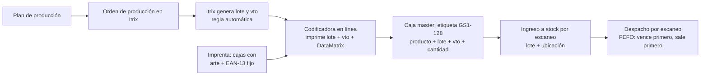

# Circuito: producción propia con código de barras + lote

## Dos formas de que la caja salga con lote
| | A. Lote pre-impreso por la imprenta | B. Lote impreso en la línea (estándar de la industria) |
|---|---|---|
| Imprenta imprime | Arte + EAN-13 + lote + vto (impresión digital de datos variables) | Arte + EAN-13 + recuadro blanco "Lote / Vto" |
| Lote/vto | Se define semanas antes | Se imprime el día real de producción |
| Riesgo | Si cambia el plan (fecha, cantidad, merma) sobran cajas con lote/vto incorrecto → descarte | Muy bajo |
| Inversión | Sin equipos, pero tiradas cortas por lote (más caro por unidad) | Codificadora (inkjet térmica TIJ para DataMatrix, o etiquetadora) |
| Lo usan | Pocas empresas, tiradas chicas y plan muy estable | La gran mayoría (alimentos, farma, cosmética) |

**Recomendación: B.** Si igual se elige A, aplicar las reglas de la sección "Si se va por A".

## Circuito propuesto (B)

1. **Plan:** producción define qué, cuánto y cuándo.
2. **Orden de producción en Itrix:** al abrirla se genera el lote con una regla fija, p. ej. `L` + AAMMDD + línea + turno → `L261014-1A`. Vto = fecha de producción + vida útil del producto.
3. **Codificadora:** recibe lote/vto (ideal desde Itrix, sin tipear) e imprime en el recuadro: texto legible + DataMatrix GS1.
4. **Caja master:** etiqueta GS1-128 impresa desde Itrix con producto, lote, vto y cantidad.
5. **Ingreso a stock:** se escanea la etiqueta y la ubicación → Itrix registra lote, cantidad y ubicación.
6. **Despacho:** se escanea al preparar el pedido → descuenta stock por lote, queda la trazabilidad cliente-lote.

## Si se va por A (lote pre-impreso)
- Plan de lotes cerrado con la anticipación que pida la imprenta (típico 3-6 semanas).
- Pedir a la imprenta cantidad del lote + margen de merma (ej. 3-5 %).
- Imprimir solo lote; el vto en línea con sello/etiqueta, o fijar vto conservador.
- Sobrantes: registrar y destruir; nunca reusar en otro lote.
- Si la producción se corre de fecha, lote y vto quedan desfasados → evaluar riesgo bromatológico/legal.

## Datos a relevar
- Cantidad de productos (SKU) y lotes por día/semana.
- Vida útil de cada producto.
- Tipo de envase (cartulina, film flexible, etiqueta) y superficie libre.
- Si la línea ya tiene codificadora/fechadora.
- Anticipación y mínimo de tirada de la imprenta; si hace impresión digital de datos variables.
- Si Itrix maneja órdenes de producción, lotes e impresión de etiquetas.
