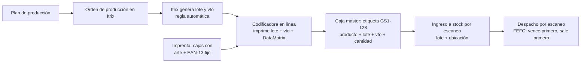

# Circuito: producción propia con código de barras + lote

## Dos formas de que la caja salga con lote
| | A. Lote pre-impreso por la imprenta | B. Lote impreso en la línea (estándar de la industria) |
|---|---|---|
| Imprenta imprime | Arte + EAN-13 + lote + vto (impresión digital de datos variables) | Arte + EAN-13 + recuadro blanco "Lote / Vto" |
| Lote/vto | Se define semanas antes | Se imprime el día real de producción |
| Riesgo | Si cambia el plan (fecha, cantidad, merma) sobran cajas con lote/vto incorrecto → descarte | Muy bajo |
| Inversión | Sin equipos, pero tiradas cortas por lote (más caro por unidad) | Codificadora (inkjet térmica TIJ para DataMatrix, o etiquetadora) |
| Lo usan | Pocas empresas, tiradas chicas y plan muy estable | La gran mayoría (alimentos, farma, cosmética) |

**Recomendación: B.** Si igual se elige A, aplicar las reglas de la sección "Si se va por A".

## Circuito propuesto (B)

1. **Plan:** producción define qué, cuánto y cuándo.
2. **Orden de producción en Itrix:** al abrirla se genera el lote con una regla fija, p. ej. `L` + AAMMDD + línea + turno → `L261014-1A`. Vto = fecha de producción + vida útil del producto.
3. **Codificadora:** recibe lote/vto (ideal desde Itrix, sin tipear) e imprime en el recuadro: texto legible + DataMatrix GS1.
4. **Caja master:** etiqueta GS1-128 impresa desde Itrix con producto, lote, vto y cantidad.
5. **Ingreso a stock:** se escanea la etiqueta y la ubicación → Itrix registra lote, cantidad y ubicación.
6. **Despacho:** se escanea al preparar el pedido → descuenta stock por lote, queda la trazabilidad cliente-lote.

## Si se va por A (lote pre-impreso)
- Plan de lotes cerrado con la anticipación que pida la imprenta (típico 3-6 semanas).
- Pedir a la imprenta cantidad del lote + margen de merma (ej. 3-5 %).
- Imprimir solo lote; el vto en línea con sello/etiqueta, o fijar vto conservador.
- Sobrantes: registrar y destruir; nunca reusar en otro lote.
- Si la producción se corre de fecha, lote y vto quedan desfasados → evaluar riesgo bromatológico/legal.

## Datos a relevar
- Cantidad de productos (SKU) y lotes por día/semana.
- Vida útil de cada producto.
- Tipo de envase (cartulina, film flexible, etiqueta) y superficie libre.
- Si la línea ya tiene codificadora/fechadora.
- Anticipación y mínimo de tirada de la imprenta; si hace impresión digital de datos variables.
- Si Itrix maneja órdenes de producción, lotes e impresión de etiquetas.

---
## Decisión: código de barras con lote impreso en producción (sin stickers en logística)

### Opción 1 – Imprenta pre-imprime el lote (requiere plan congelado)
Funciona solo si se cumplen TODAS:
- Plan de producción congelado con la anticipación de la imprenta (ej. 4–6 semanas).
- Lote **secuencial no atado a la fecha** (L0001, L0002…) para que un atraso no invalide la caja.
- Vencimiento **fuera** del código pre-impreso: se sella en línea con fechadora simple; Itrix lo asocia al lote.
- Tamaño de lote fijo (= cantidad de cajas impresas) + margen de merma 3–5 %.
- Cajas sobrantes de un lote: se registran y destruyen (no se pasan a otro lote).
- Control en Itrix: cajas impresas vs producidas vs destruidas por lote.

### Opción 2 – Impresión directa en la caja en la línea (recomendada)
La imprenta entrega cajas con arte + EAN-13 + recuadro blanco. En producción una impresora
imprime **directo sobre el cartón** el GS1-128 (01+10+17) + texto "Lote / Vto". Sin etiquetas.

| Volumen | Equipo | Cómo se usa |
|---|---|---|
| Bajo (manual) | Impresora inkjet térmica (TIJ) **de mano** | El operario la pasa sobre cada caja |
| Medio/alto | **TIJ fija sobre cinta transportadora** + sensor | Imprime sola al pasar la caja |
| Caja master | TIJ de cabezal ancho o **print & apply** (imprime y pega etiqueta) | Automático al final de línea |
| Envase flexible (film) | Impresora de transferencia térmica (TTO) | Integrada a la envasadora |

Requisitos al proveedor: imprimir GS1-128 y DataMatrix verificables, superficie (cartulina/corrugado),
altura de impresión ≥ 12,7 mm, conexión con PC/Itrix para recibir lote y vto sin tipear.

### Ojo con el tamaño
GS1-128 con producto + lote + vto mide ~8–11 cm de ancho. Si la caja chica no tiene lugar,
usar DataMatrix GS1 (mismos datos, ~1–2 cm) o dejar el EAN-13 para venta y el GS1-128 en la caja master.
Si el producto se vende en supermercados, la unidad igual necesita el EAN-13 (las cajas de venta no leen GS1-128).

### Implementación
1. Relevar SKUs, volumen por turno, tipo de caja y espacio libre.
2. Rediseñar arte con recuadro blanco y mandar a imprenta.
3. Pedir demo a 2–3 proveedores de codificación con cajas reales.
4. Configurar en Itrix: orden de producción → lote + vto → envío a impresora.
5. Piloto con 1 producto 2 semanas; validar lectura con el lector.
6. Extender al resto.
